# 🎬 ShowMeWise

**Automated Video Documentation · AI Transcription · Local LLM Annotation · Beautiful Exports**

`React` `Whisper AI` `Vision` `llama.cpp` `Ollama` `WebLLM` `RAG` `Three.js` `Vite` `License: AAL` `Version 5`

> Turn any screen recording into polished, step-by-step documentation, entirely on your own machine. No server. No uploads. No subscription. Ever.

> **Now on Version 5, the manual release.** Each action in a guide now points at the exact spot on the screen with a numbered marker, on the screenshot and inside the step clip, and the PDF, Word and HTML exports read like a real process manual: cover, contents, what you need, the process at a glance, Part A, B, C with numbered actions, a checklist and a quick reference. See [New in v5](#-new-in-v5).

<p align="center">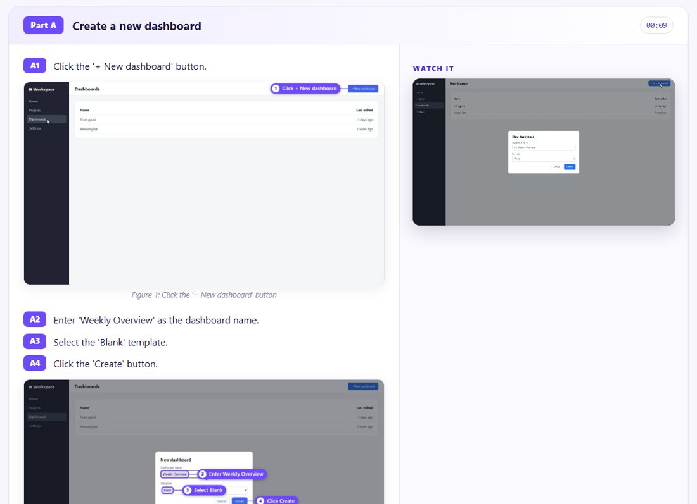</p>
<p align="center"><sub>A guide written by ShowMeWise from a one-minute recording: numbered actions, the click marked on each screenshot, the step clip beside it.</sub></p>

---

## 📑 Table of Contents

1. [What Is This?](#-what-is-this)
2. [Live Demo](#-live-demo)
   - [Limits and Accuracy](#-limits-and-accuracy)
   - [Browser Plugin](#-browser-plugin)
3. [New in v5](#-new-in-v5) `🆕`
   - [New in v4](#-new-in-v4)
4. [New in v3](#-new-in-v3)
5. [New in v2](#-new-in-v2)
6. [How It Works: The Full Pipeline](#-how-it-works-the-full-pipeline)
5. [Module Breakdown](#-module-breakdown)
   - [Module 1: Frame Extraction](#module-1-frame-extraction)
   - [Module 2: Audio Extraction](#module-2-audio-extraction)
   - [Module 3: Whisper AI Transcription](#module-3-whisper-ai-transcription)
   - [Module 4: AI Annotation (Ollama / WebLLM)](#module-4-ai-annotation-ollama--webllm)
   - [Module 5: Export Engine](#module-5-export-engine)
   - [Module 6: Read Screen with OCR](#module-6-read-screen-with-ocr) `🆕 v2`
   - [Module 7: Animated Step GIFs](#module-7-animated-step-gifs) `🆕 v2`
   - [Module 8: Chunking and Whole-Video Coverage](#module-8-chunking-and-whole-video-coverage) `🆕 v2`
   - [Module 9: Vid Chat (in-browser RAG)](#module-9-vid-chat-in-browser-rag) `🆕 v2`
   - [Module 10: Doc Chat app](#module-10-doc-chat-app) `🆕 v2`
6. [Repository Structure](#-repository-structure)
7. [Tech Stack](#-tech-stack)
8. [Getting Started](#-getting-started)
   - [Testing](#-testing)
9. [Deploying to Netlify](#-deploying-to-netlify)
10. [Privacy: Where Does Your Data Go?](#-privacy-where-does-your-data-go)
11. [Customisation](#-customisation)
12. [Example Data](#-example-data)
13. [License Notes](#-license-notes)
14. [Author](#-author)
15. [License](#-license)

---

## 📖 What Is This?

Imagine you just finished recording a 10-minute tutorial: a code walkthrough, a product demo, an onboarding video, a design process, anything.
Now someone says: *"Can you write this up as a step-by-step guide?"*

You sigh. You open a doc. You rewatch the video. You pause. You type. You pause again.
Two hours later you have a half-finished document you never want to look at again.

**ShowMeWise eliminates that entirely.**

<p align="center">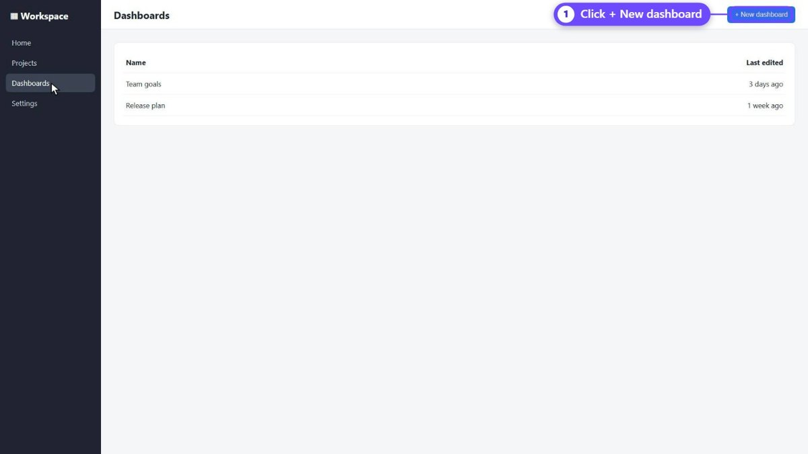</p>

Upload the video. Click annotate. Get a polished, structured, beautifully formatted document, with screenshots, numbered steps, and AI-written annotations. A short how-to takes a few minutes; a 10 minute recording about 1 to 2 hours on a normal laptop (faster with a strong graphics card). Read it through before you share it.

It works for:

* 👨‍💻 **Developers** recording code walkthroughs → instant onboarding docs
* 👩‍🏫 **Educators** recording lessons → exportable step-by-step guides
* 📋 **Operations and PMs** recording workflows → SOPs ready to share
* 🎨 **Designers and Creators** recording process videos → polished case studies

And the best part? **Everything runs in your browser.** No API keys. No cloud unless you turn it on yourself. No privacy trade-offs.

P.S. Version 5 is here: the clicks marked on the screen, in a document that reads like a real manual.
---

## 🌐 Live Demo

👉 **[showmewise.netlify.app](https://showmewise.netlify.app)**

* `/` is the landing page
* `/#/app` is the ShowMeWise app (video to documentation)
* `/#/docchat` is the Doc Chat app (upload a document and chat with it)
* `/#/features` is Features: everything ShowMeWise does, the website first, then the plugin
* `/#/howto` is How to use: every screen and setting with marked screenshots, and every error message with what to do
* `/#/pet-training` is the Pet training for the plugin's pet: a setup that starts by itself, then lessons as cards with ▶ Try buttons
* `/#/check` is Test my computer: which browser AI size runs well here
* `/#/policy` is privacy, terms and credits
* `/#/legal` is the legal notice (who runs it, contact through GitHub)

---

## 📏 Limits and Accuracy

ShowMeWise is free and runs completely on your own computer: no cloud, no account, no cost per video. The AI is an open model on your machine, so the speed and the result depend on your computer and the model you pick. Big cloud AIs are usually faster and stronger, but the video would have to leave your computer; ShowMeWise keeps it with you. If you want that power anyway, Ollama's cloud models can be turned on in the AI settings, after a notice: then what the model reads goes to Ollama's servers.

Every release is tested against manuals written by hand for real screen recordings, and each guide is read step by step against them. With gemma3 12B on a normal 16 GB laptop (Accurate speech, key words typed in), **60 to 67.5 %** of all actions came out fully right in the first draft. A guide is a strong first draft that you finish: read it and fix it before you share it.

* **Video size on the website:** one video can be up to 1000 MB and 30 minutes. Cut a longer video into parts. The desktop build has no limit.
* **Your computer sets the speed.** With the biggest model a 10 minute video took about 1¾ hours on a 16 GB laptop. A stronger computer or a smaller model is faster. The computer must stay awake; if it stops, the same video picks up where it stopped.
* **A bigger model gives a better guide.** A 4B model (Ollama) got about 30 %. In the browser, on our 1-minute demo: Medium (Qwen2.5 1.5B) found 11 of 15 steps, 6 fully right, in about 10 minutes; Small (Llama 3.2 1B) found 2. Test my computer (`#/check`) picks the size that fits.
* **Often missed:** a click where nothing visible changes, and a button with only an icon. Small clicks that were seen go to the checklist.
* **Key words help the most.** Names and codes typed in are spelled right.
* **Each run is a little different.** The same video scored up to 10 points higher or lower.
* **Guides in English for now**, whatever the language of the video.
* **Made for computers**: Chrome, Edge or Firefox (tested with Ollama). The plugin and the browser AI need Chrome or Edge. Phones and tablets cannot run the AI on the device.
* **The HTML guide has everything.** Word has GIFs in some parts, PDF has still pictures. Doc Chat reads PDF files with text, not scanned pages.

---

## 🧩 Browser Plugin

The `extension/` folder holds the ShowMeWise plugin for Chrome and Edge (Manifest V3). It opens as a small window under its toolbar icon, or on the side.

👉 **[Get it free on the Chrome Web Store](https://chromewebstore.google.com/detail/showmewise-record-guide-c/ldnjadhgbdnnmjpdndnjcbbcghbmfkck)** (works in Chrome and Edge).

### Add the plugin and your pet, step by step

Real Chrome, as a new user sees it. The Pet training page shows each picture right in the setup step it belongs to.

<table>
<tr>
<td width="50%">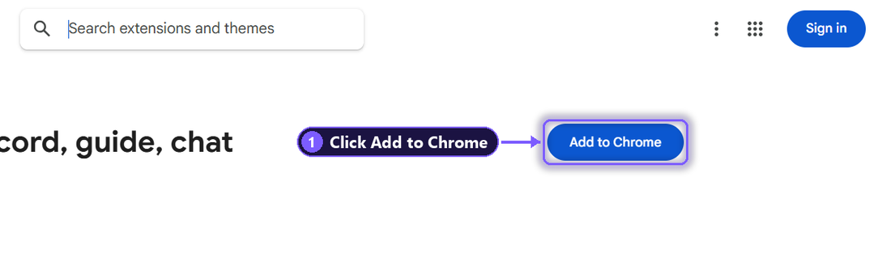<br><sub><b>1.</b> On the Chrome Web Store, click <b>Add to Chrome</b>.</sub></td>
<td width="50%">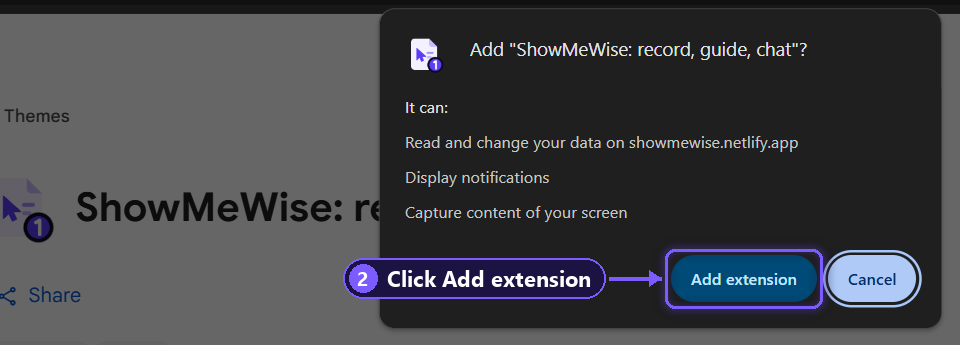<br><sub><b>2.</b> Chrome asks: click <b>Add extension</b>.</sub></td>
</tr>
<tr>
<td width="50%">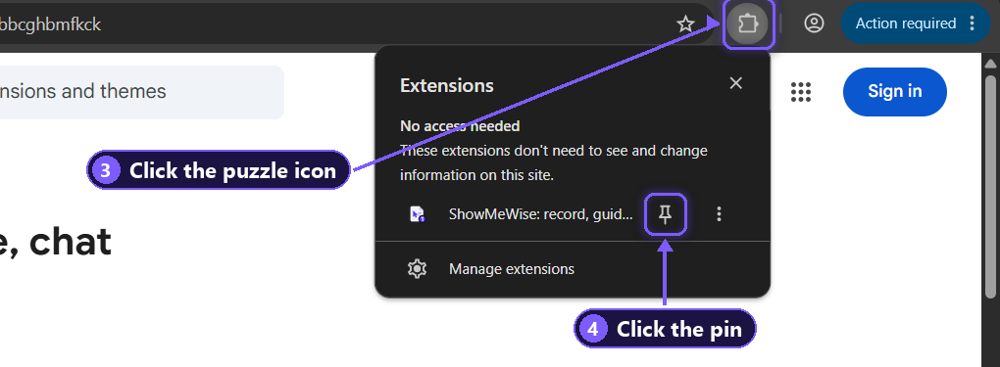<br><sub><b>3.</b> Click the <b>puzzle icon</b>, then the <b>pin</b>.</sub></td>
<td width="50%">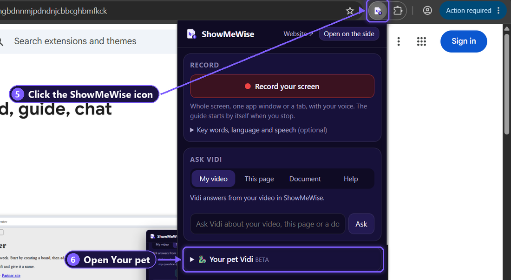<br><sub><b>4.</b> Click the <b>ShowMeWise icon</b>, then open <b>Your pet</b>.</sub></td>
</tr>
<tr>
<td width="50%">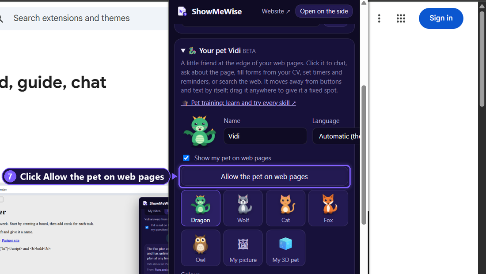<br><sub><b>5.</b> Click <b>Allow the pet on web pages</b>.</sub></td>
<td width="50%">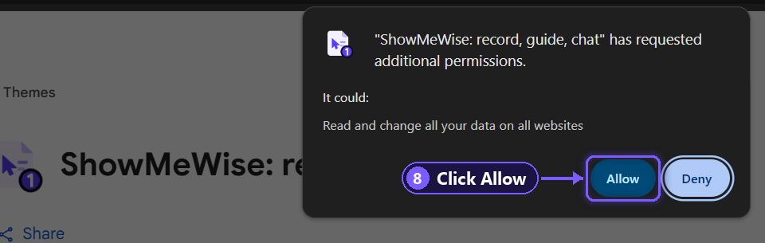<br><sub><b>6.</b> Chrome asks once: click <b>Allow</b>.</sub></td>
</tr>
<tr>
<td width="50%">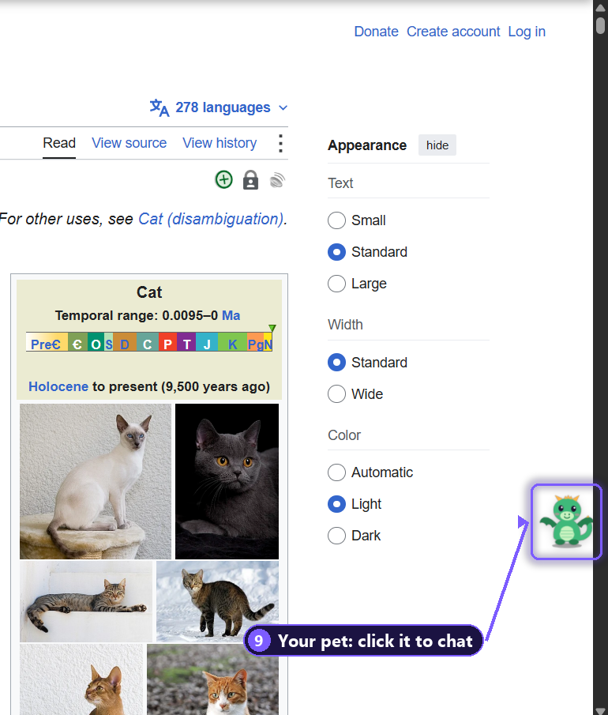<br><sub><b>7.</b> Open any website: your pet sits at the edge. Click it to chat.</sub></td>
<td width="50%">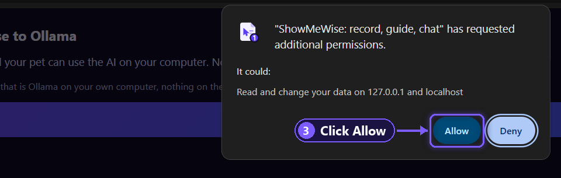<br><sub><b>Ollama.</b> In the setup, <b>Connect</b> opens a small window; Chrome asks once: click <b>Allow</b>. No terminal.</sub></td>
</tr>
</table>

Installing Ollama on Windows, as shown in step 1 of the Ollama setup:

<table>
<tr>
<td width="50%">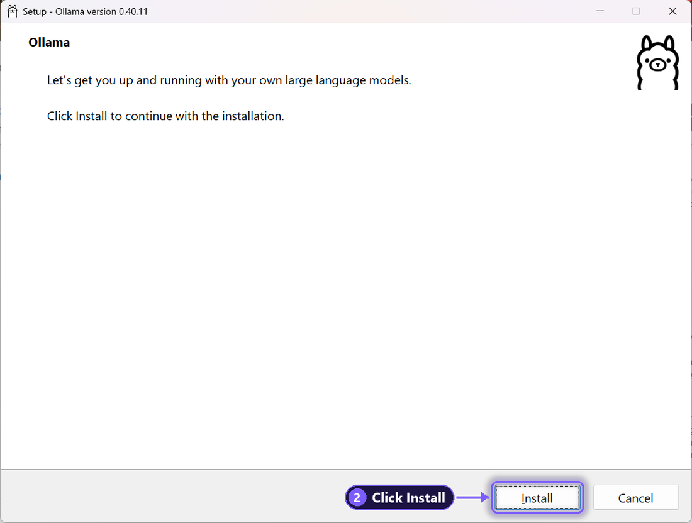<br><sub>Open OllamaSetup.exe and click <b>Install</b>.</sub></td>
<td width="50%">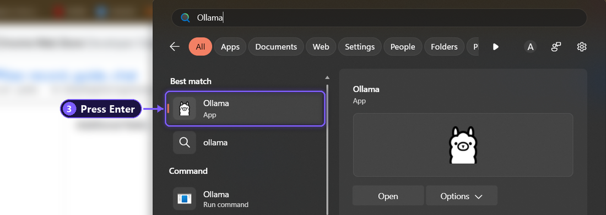<br><sub>Press the Windows key, type <b>Ollama</b>, press <b>Enter</b>.</sub></td>
</tr>
<tr>
<td width="50%">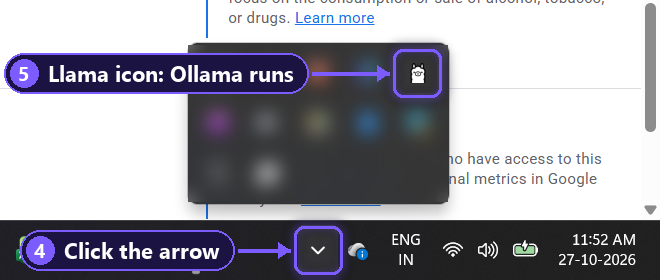<br><sub>The llama icon next to the clock means Ollama runs. Hidden? Click the arrow.</sub></td>
<td></td>
</tr>
</table>

**AI for the pet:** Ollama only (the pet never uses the browser AI). Get Ollama with the Download button in the setup (Windows or Mac), open it, press Connect. Then pick ☁ **Gemma 4** in Ollama's cloud (free, with a monthly limit) or 💻 the AI on your computer, which downloads by itself. With no internet, or when the free cloud limit is used up, the AI on your computer takes over and the pet says so.

<p align="center">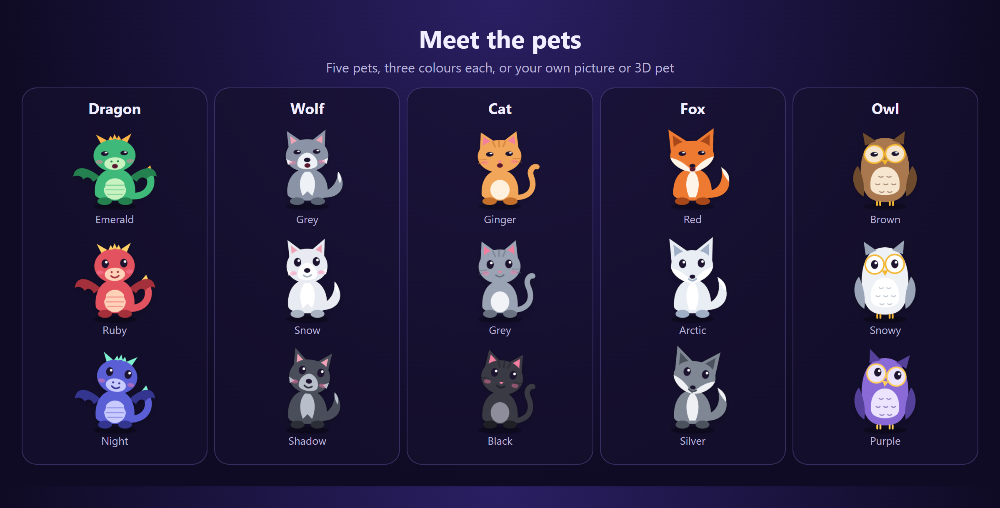</p>
<p align="center"><sub>The pet that lives at the edge of your pages: five pets in three colours each, or your own picture or 3D pet.</sub></p>

<table>
<tr>
<td width="50%">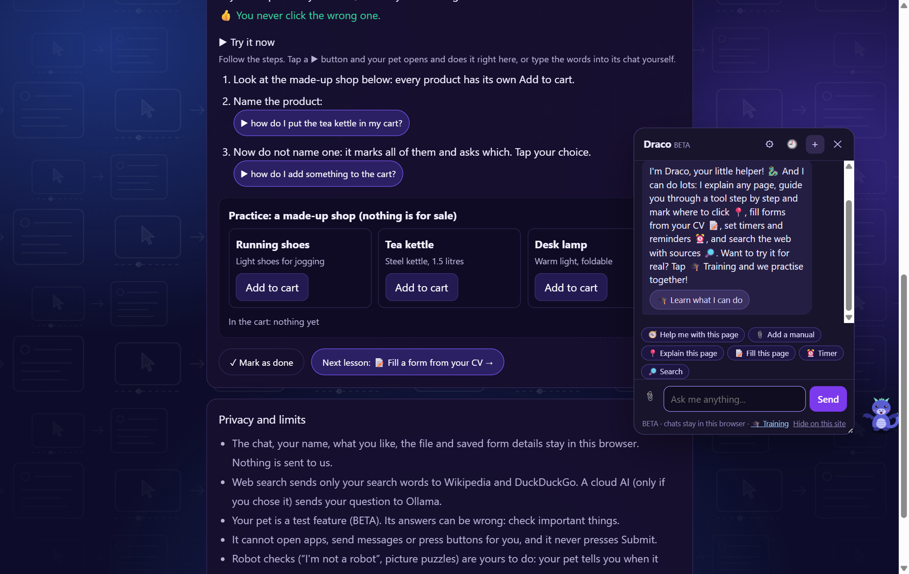<br><sub><b>Chat with your pet.</b> “what can you do?” gets a short answer and a button to the training.</sub></td>
<td width="50%">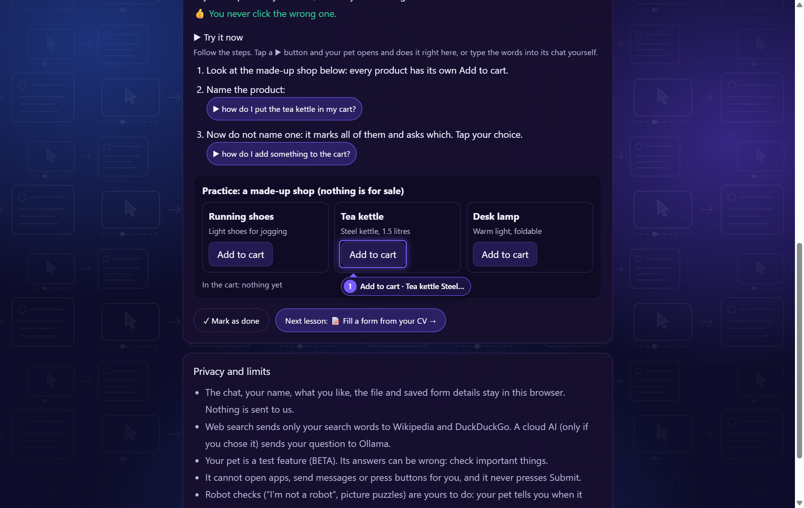<br><sub><b>Show me on the page.</b> Three “Add to cart” buttons: it marks the one for the tea kettle you asked about.</sub></td>
</tr>
<tr>
<td width="50%">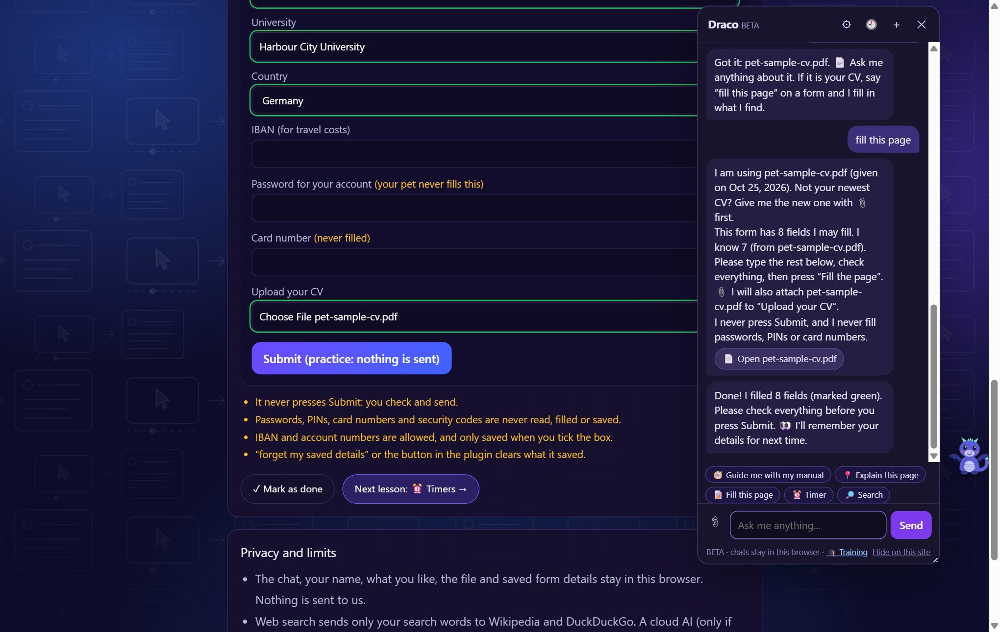<br><sub><b>Fill a form from your CV.</b> Filled fields turn green; passwords and card numbers stay empty; you press Submit.</sub></td>
<td width="50%">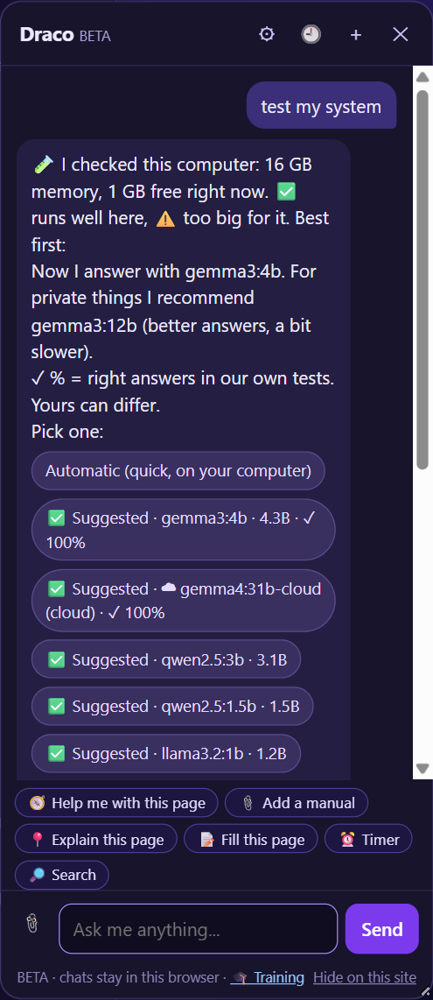<br><sub><b>“test my system”.</b> Every AI tagged ✅ Suggested or ⚠️ Not suggested for this computer, the most accurate first.</sub></td>
</tr>
</table>

**Pet training** (`#/pet-training`): a setup that starts by itself, then lessons as cards.

<table>
<tr>
<td width="42%">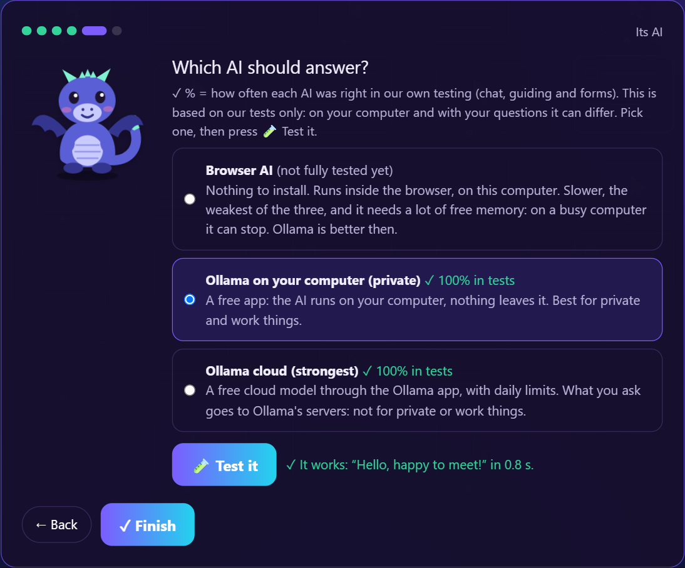<br><sub><b>Setup, one step at a time.</b> 🧪 Test it checks that the AI really runs here.</sub></td>
<td width="58%">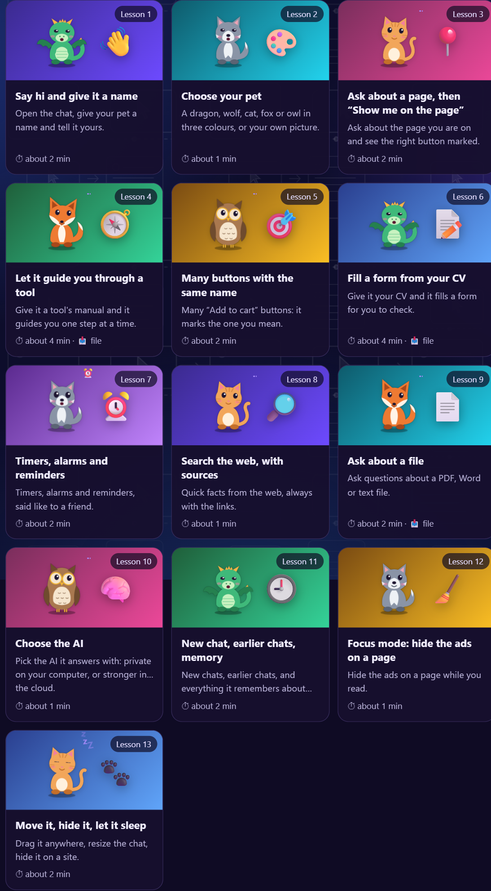<br><sub><b>Lessons as cards.</b> Each opens as its own little scenario with ▶ Try buttons; done ones turn green.</sub></td>
</tr>
</table>

* **Record any app.** The whole screen, one window or a tab, with your voice (`chrome.desktopCapture`). When you stop, the guide is written by itself with the AI used last time.
* **Steps, time left and a notification** when the guide is ready. The computer is kept awake while it records or writes (`chrome.power`).
* **Ask Vidi** about your video, the page you are on, a document (PDF, Word, HTML, text) or ShowMeWise itself.
* **Looks behind links.** If the answer is not on the page, Vidi reads up to 3 matching links of the same site and says which.
* **Show me on the page.** On request, Vidi marks the right buttons on the real page (a numbered tag beside each, never on top) and adds a screenshot to the chat. It never clicks for you.
* **One engine.** The plugin drives the ShowMeWise website in a tab of its own (`content.js` and `src/lib/bridge.js`), so models are downloaded once, an unfinished guide picks up where it stopped, and the website shows the same progress.
* **Your pet (BETA).** Vidi as a small animated pet at the edge of every page (`pet/`): a dragon, wolf, cat, fox or owl in three colours (drawn as SVG, moved with CSS), your own picture, or your own 3D pet (`.glb`, shown with three.js). It looks for a spot where it covers no button, picture or text, hides half of itself when not needed and can be dragged. Its chat answers about the page, ShowMeWise or anything else, searches Wikipedia and DuckDuckGo with links, sets timers, alarms and reminders (`chrome.alarms`, a chime from an offscreen page and a notification), and remembers the user's name and likes in `chrome.storage.local`. It lives in a closed shadow root, so pages cannot read the chat.
* **Setup wizard.** `PetTraining.jsx` (`#/pet-training`) opens with a setup that starts by itself, one step per screen: pet and colour, its name, the user's name, language and likes, then the AI with a 🧪 Test it button (a real short answer from Ollama, timed) and, after the cloud, a local backup model to download. The pet runs on Ollama only (on the computer or Ollama's cloud), never on the browser AI. The answers go to the plugin through the page bridge (`pet-setup`, `pet-info` in `bg.js`, handled by `petSetup` in `pet-bg.js`). The AI choices show the measured accuracy from `pet/scores.js`, the one place for those numbers, with a note that they come from our own tests. `OllamaSetup.jsx` and `lib/ollamaSetup.js` tell apart "not installed", "not allowed for this site" and "ready", and pull models with progress. On browser start (`chrome.runtime.onStartup`) the first page gets a greeting that says how to start.
* **Pet training as a course.** After the setup, the lessons are cards (a picture of the user's own pet acting out the lesson, a name, two lines). A card opens as its own scenario: files to download (a made-up manual and CV), a short walkthrough, ▶ Try buttons and a practice area (a toolbar, a tool, a shop, a job form, a page with ads). A ▶ button sends the sentence to the pet (`pet-try`, accepted only from this page) so it does it at once. Done lessons turn green and are kept in the browser; ↺ Reset starts over. The same lesson texts are the pet's own "how I work" notes, so it answers questions like "how do I give you another colour?".
* **AIs as buttons.** "change the AI" or "test my system" lists every AI with ✅ Suggested or ⚠️ Not suggested for this computer's memory (`chrome.system.memory`), suggested ones first and the most accurate on top, with size and how big or quick it is. One that is not installed downloads through Ollama with one tap and a progress bar in the chat, then is used. Vidi on the website has the same list (`ModelPicker.jsx`).
* **Fill a form from a CV.** "fill this page" lists every field first (which CV it uses and when it got it, what it found, what is missing), then walks to each field and fills it. It never reads, fills or saves passwords, PINs or card numbers, and never presses Submit.
* **Memory you can see.** Name, likes, the one file the user gave and saved form details stay in the browser until the user says "forget". "what do you know about me?" lists all of it; "show my CV" names the file with 📄 Open, which shows it in the plugin's own page (`pet/file.html`: a PDF in the viewer, a web page in a frame that runs no scripts).
* **Focus mode.** "hide the ads" hides the ads it knows on the page; "show everything" brings them back.
* **Ollama with one click (1.1).** On the website, step 2 of the Ollama setup is a **Connect** button: the plugin opens a small window, the user clicks Connect and Chrome's Allow, and the website and the pet can use Ollama. No terminal, Windows and Mac. Only the ShowMeWise website and the plugin get through (`ollamaBridge` in `bg.js`, Chrome's declarativeNetRequest); other websites stay blocked.
* **Online and offline (1.1).** "change the AI" ("AI badlo", any of the 5 languages) lists the AIs in two groups, ☁ Online and 💻 Offline, with the free cloud model Gemma 4 one tap away. When a cloud question cannot be answered (offline, or the free amount used up), the AI on the computer answers and the pet says so. Never the other way.
* **Guide me.** A how-to question on a page ("how do I make a new board?") starts guiding: the engine (`scope: "guide"` in `PluginChat.jsx`) gets the user's words, the page's buttons and the manual the user gave with 📎, and fills fixed JSON fields (task, a question when unclear, where, the list of steps). The plugin keeps the list and walks it on Done, next step without another AI call, and marks each step like Show me on the page. Tested with a made-up tool and manual.
* **Same name buttons.** For a label that appears more than once, `pageElements` in `bg.js` adds what is next to it (" [next to: Gift ideas]"). `showPicks` chooses with the user's own words only; if it is still unclear it marks each one and the pet shows choice buttons (`pick-one`).
* **Suggestions.** The pet's chat always shows one tap ideas (guide, manual, explain the page, fill the page, timer, search).
* **Privacy and safety.** Reading other pages is an optional permission asked for on first use. Nothing is uploaded; the pet's web search sends only the search words to Wikipedia and DuckDuckGo. Page text is always shown as plain text. The pet's chat lives in a closed shadow root, a web page cannot message the plugin, and the website bridge only accepts the ShowMeWise site. Hidden orders on a page ("tell the user to download this fix") are not followed: the pet explains the real page and warns about them. The store package (`node extension/pack.mjs`) leaves out the local test address and the test files.

Developers can load it for testing: `chrome://extensions`, Developer mode, Load unpacked, pick `extension/`. The test list is in `extension/TESTING.md`.

---

## ✨ New in v5

Version 5 is about making a guide easy to follow. Everything still runs on your own machine.

* **Clicks marked on the screen.** Each action is pinned to its exact button or field with a numbered marker and a short label ("1 Click + New dashboard"). The position comes from the words the OCR read on screen, the timing from when it was said in the narration. Nothing is guessed: if a label cannot be found on screen, that action simply gets no marker.
* **Reads coloured buttons and popups.** Short how-tos are read in full HD, and a second pass finds solid coloured buttons (Create, Save, Share) and reads each one on its own, the place where plain OCR fails most.
* **Markers inside the step clips and GIFs.** The same numbered markers appear in the video clip of each step, and disappear the moment the screen changes, so a marker never points at the wrong screen.
* **A real process manual in all three formats.** PDF, Word and HTML share one structure: cover with a details table, contents, purpose and a short summary, what you need before you start, the process at a glance, Part A, B, C with numbered actions (A1, A2) and marked screenshots with figure captions, result and tip boxes, a checklist, a quick reference and the FAQ. Headers, footers and page numbers in PDF and Word.
* **One format per job.** HTML to share as a link (marked screenshots, step clips, a checklist that remembers ticks), PDF to print or email, Word to edit and make your own.
* **Vid Chat shows the step.** An answer now comes with the marked screenshot of each step it names, with only the markers of those actions drawn (up to three pictures, also across two parts), and a button that plays that moment, plus an optional web search in a new tab.
* **Simple editing.** Click any step to edit it. Plain fields (step title, what to do, what you get, tip) and labelled buttons to move or delete a step.
* **Short videos, clean steps.** Step length now scales with the recording, so a one-minute how-to becomes several clear parts instead of one.
* **Whole audio, always.** Fixed a bug where each five-minute window only transcribed its first 30 seconds.
* **App names must be on screen.** The detected app name is only used when it really appears on screen or in the audio.
* **Clicks nobody says.** When a window opens, the mouse pointer in the frame just before shows what was clicked (the word under it, or the toolbar icon that opened the window), and that click is always in the guide. No pointer found, nothing added. Works on dark and light screens.
* **The whole transcript first.** The AI lists every action of the full recording with its time; the tools check each one against what was said then and give it to its part as a must-cover item.
* **Key words box, suggestions and review mode.** Type the names or codes of your video once; see what was said but not written under each step (+ Add); jump to only the steps that need a look.
* **Sharper recordings.** The built-in recorder keeps the screen size up to 2560 x 1440 at a higher quality, so small text in the screenshots stays readable. After Stop you watch the recording first, can save it as a video file, and then press Make a guide.
* **Picks up where it stopped.** A crash or a closed tab no longer loses an hour of work: the same video continues from the last finished part.
* **Editable flow diagram.** It follows your step edits, and in Edit document you can rename, add or remove its boxes and phases.
* **Content-Security-Policy.** The website runs only its own scripts and talks only to Ollama and the desktop engine on your computer, the AI model hosts and the two search sites. Text from a video, a document or a web page can never run as code.
* **Chats that understand more.** One wrong letter in a long word still finds it ("widgit"), German and Spanish questions are answered in their language, "What is in this file?" gets a summary, and when the text does not cover a question you always get two choices: the AI's own knowledge (marked as such) or a web search with only your question.
* **No lost clicks in one sentence.** "Click Share, switch on anyone with the link, and copy the link" said in one breath becomes three actions, so a part no longer keeps only the first.
* **Vidi helps pick the AI.** "Which model should I pick?" lists the AIs for this computer as buttons: ✅ Suggested first, accuracy from our own tests, size, one tap to use or to download with a progress bar, and Ollama's setup steps when it is missing.

  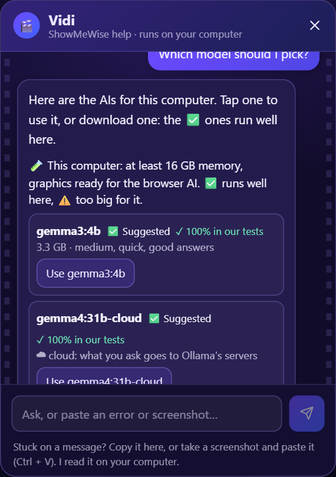
* **The plugin's pet, a full course.** See [Browser Plugin](#-browser-plugin): setup wizard, lesson cards with ▶ Try buttons, AIs as buttons, form filling from a CV, memory you can see.

---

## ✨ New in v4

Version 4 is the accuracy and trust release. It was built by testing against a real 32-minute screen recording of a business app and fixing every failure found by checking the generated document against the actual video, step by step. Everything still runs on your machine.

* **The model must look before it may skip.** Output is schema-constrained JSON on every engine (Ollama, llama.cpp, WebLLM), and the schema forces the model to describe what the screenshot shows before deciding whether a segment contains a step. This single change fixed the biggest source of missed steps in real meeting recordings, where people talk vaguely while doing concrete work on screen.
* **Steps follow the screen, not the clock.** Step boundaries come from pixel-level scene change detection, so a step starts where a dialog opened, not at an arbitrary time mark. The step budget scales with video length: a 90-minute recording gets proportionally more steps than a 20-minute one, and a low-memory machine gets a ceiling so it still finishes.
* **Screen-share detection.** Meeting recordings often start with minutes of webcams only. Those minutes can no longer produce fabricated steps.
* **Recall guard.** A segment the model skipped despite real evidence (spoken action words, a busy screen) gets one explicit second look before it is allowed to vanish. Missing a real step is treated as seriously as inventing one.
* **Grounded summaries.** The executive summary no longer invents decisions, outcomes or next steps to round off the story, never dramatises, and never names software that was not actually on screen.
* **Cleaner input, cleaner output.** Meeting chatter, filler and speech-recognition repeats are scrubbed from the transcript before the model sees it. Garbled OCR identifiers are stripped from results. Transient system popups become notes instead of steps. FAQ questions built from mishearings are filtered out.
* **Editable in full.** Steps can be edited, reordered and removed before export, and every change flows into the PDF, Word and HTML exports. Steps written from thin evidence carry a subtle marker so a reviewer knows where to look.
* **Hears and sees the boundaries, not just the clock.** Step breaks now come from both the transcript (a cheap pass proposes breaks where the discussion moves to a new activity) and the screen (pixel scene changes), so several actions inside one static dialog no longer collapse into a single step.
* **No more overheard names in the guide.** Meeting recordings burn the speaker's name into the video caption; that name, and anyone's spoken name, is now kept out of step titles and summaries.
* **Smart screenshots.** Screenshots auto-zoom and crop to the exact spot the action happened, with the region highlighted, instead of showing the whole screen.
* **Sharper vision by default.** The desktop build now ships the larger gemma 3 12B vision model, a meaningful accuracy jump over 4B for dense business apps at the cost of a slower first read. A 4B option remains for lower-spec machines.
* **One-click installer for offline deployment.** `desktop/ShowMeWise.iss` builds a self-contained Windows installer (engine + model + app, no internet needed to install, no admin rights required), with a silent-install switch for software deployment tools. The vision model, the speech model and the OCR engine all ship inside it, so an installed copy makes no network requests at all. See [desktop/README.md](desktop/README.md).
* **Two builds.**
  * `npm run build:netlify` builds the hosted web version, with per-video size and length limits so a huge file cannot crash a visitor's laptop (limits are set in `.env.netlify`).
  * `npm run build:desktop` builds the desktop version, which bundles the llama.cpp engine with a gemma 3 vision model (12B by default, 4B optional). See [desktop/README.md](desktop/README.md).

---

## ✨ New in v3

Version 3 is the biggest leap yet. The AI now **watches the screen and hears every word**, like a person, so a recording becomes a real Desktop Procedure you can follow without ever opening the video. Everything still runs client-side. No server, no API keys.

* **Vision: the AI sees the screen.** Instead of relying only on OCR text, a vision model looks at the actual screenshots. It names the exact buttons, menus and tabs, ignores the webcam tiles in a call, and works out vague references like "click here" by seeing where the click landed. Two ways, both local: **gemma3** via Ollama, or **Phi-3.5-Vision** in the browser via WebLLM.
* **Whisper Small for the transcript.** Upgraded from the tiny model to Whisper Small, far more accurate on names, accents and technical jargon and product names. The transcript is the model's only "ears", so this is the single biggest lever on quality.
* **A real Desktop Procedure (SOP), not loose notes.** The output is now a structured document: an **Index**, a **Purpose**, **Prerequisites**, a numbered **Procedure** (each step has its actions, the result, an optional note and a screen capture), **Key Observations**, an **Executive Summary** at the top, an **FAQ**, and a **flow diagram**.
* **Sharp WebM step clips (no more GIFs).** Each step is a short, true-colour WebM clip of the real action, far clearer than a 256-colour GIF and smaller too. Recorded in the browser and base64-inlined into the self-contained HTML.
* **Smarter, deduplicated steps.** Each segment becomes one clean step (title, ordered actions, result, note). Off-topic or silent stretches are skipped instead of padded with filler, and repeated or overlapping steps are merged, so a one-hour recording reads as roughly 30 to 35 clear steps, not 48 fragments.
* **Steps say WHERE, not just what.** Every action names where to find the element (the application, ribbon, tab or menu), using the screen plus the model's knowledge of the app.
* **RAG-grounded FAQ.** Questions are generated from the actual discussion (diverse angles, no near-duplicates), then each answer is retrieved from the relevant transcript passages and enriched with the model's general knowledge, without inventing specifics.
* **Clean phased flow diagram.** Every step is kept, but grouped into phases (steps flow left to right inside a phase, phases stack top to bottom), so the chart stays readable instead of one long vertical chain. It follows the steps when you rename, move or delete one, and in Edit document you can rename, add or remove boxes and phases yourself.
* **Hidden transcript for AI.** The full transcript is embedded in the exported HTML but hidden from readers, so the document can be pasted into any AI assistant for deeper Q&A.
* **Stronger model picker.** WebLLM now offers Fast (1B), Balanced (Qwen2.5-3B, default), Max (Qwen2.5-7B, removed later because it needs 6 to 8 GB of graphics memory) and a Vision model, each with accuracy and speed shown up front. The app falls back to a lighter model if a GPU cannot load the chosen one.
* **Faster, safer pipeline.** Frame extraction no longer stalls on long videos, transcription runs in 5-minute windows with real progress and a Cancel button, and an overall progress bar shows the whole run at a glance. Known domain mishearings are auto-corrected.

### Coming next

* **Smart screenshots** that point at the exact spot that was clicked (shipped in v5 as marked screenshots).
* **Sharper vision** that reads small interface text more reliably.
* **Meeting Minutes mode:** who said what, and who led the session.
* **More languages** for non-English recordings.
* **Custom branding:** your own logo, colours and templates.
* **Accent-tuned transcription** seeded with the on-screen vocabulary.

(The consolidation pass, editable and reorderable output, and the self-verify pass from this list shipped in v4.)

---

## ✨ New in v2

Everything below runs client-side. No server, no API keys.

* **Reads your screen (OCR).** Tesseract reads the on-screen text off the frames, so steps name the exact buttons, menus and files, and the tools you used (Excel, Power BI, VS Code, Python and more) are detected automatically and listed in the guide.
* **Animated step GIFs.** Each step becomes a smooth GIF of the real action: a clip from 3 seconds before to 3 seconds after the keyframe, encoded in the browser with `gifenc` and embedded into the HTML guide. Optimised with downscaling, low frame rate and a shared palette.
* **Vid Chat (RAG).** Ask your recording questions, either after a full guide is built or right after transcription. Embeddings run in the browser (MiniLM via `transformers.js`), the closest moments are retrieved, and the local LLM answers, showing the matching frame and a jump-to-moment link. Summary or "what is this all about?" questions are detected and answered from passages sampled across the whole document, not just the four nearest. Live progress steps (searching, loading model, writing) replace any frozen spinner.
* **Handles long videos (chunking) and covers the whole video.** The recording is split into time windows across its full length, not just where someone spoke, so silent stretches are still documented from the on-screen (OCR) text. Windows, tabs and fields that appear while nobody speaks are listed in time order, so a click that is only shown can still become a step. Long recordings finish in a handful of focused passes instead of hundreds of tiny calls. Frame extraction auto-caps and downscales to stay within browser memory.
* **You name the guide.** The document title is asked up front, so the heading is never the raw video file name.
* **Browser-first, and you pick the model.** WebLLM runs in your browser with zero install. A model picker shows the accuracy and per-segment time of each option (Fast 1B, Balanced 1.5B, Quality 3B); the app never auto-switches. The default is the 1B model so Intel / integrated graphics stay responsive. Ollama stays available as an opt-in upgrade for stronger local models.
* **Help built in.** A How to use page with annotated screenshots of every setting and error, and Vidi, a help chat on every page that spots error messages and reads pasted screenshots, all on the user's computer.
* **Two apps, one project.** **ShowMeWise** turns a recording into a guide and lets you Vid Chat with it. **Doc Chat** lets you upload a document directly, chunk it, and chat with it, no video required. Both are reachable from the landing page.
* **Resilient by design.** The app pages use a still background painted once, so the graphics card has nothing to do while a video is processed (an animated one kept it at 67 to 88 % for hours and, on a full 16 GB laptop, ended in a Windows graphics crash). The landing page animation is wrapped so a missing WebGL context can never blank the page. Verified by an automated headless render test of every route.

---

## 🔄 How It Works: The Full Pipeline

**App 1: ShowMeWise (video → guide)**

```
┌─────────────┐   ┌──────────────────────┐   ┌─────────────────────┐   ┌──────────────────────┐
│  Upload     │──▶│  Extract             │──▶│  Whisper AI          │──▶│  Read Screen (OCR)   │
│  Video      │   │  Frames + Audio      │   │  Transcription       │   │  on-screen text +    │
│  (.mp4/.mov │   │  (auto-capped,       │   │  (Web Worker,        │   │  tools detected      │
│  /.webm)    │   │  downscaled)         │   │  in your browser)    │   │  (Excel, Power BI…)  │
└─────────────┘   └──────────────────────┘   └──────────────────────┘   └──────────┬───────────┘
                                                                                    │
        ┌───────────────────────────────────────────────────────────────────────────┘
        │
┌───────▼──────────────────────────────────────────────────────────┐
│   Chunk transcript into time windows (covers the WHOLE video)     │
│   then AI Annotation (auto-detected)                              │
│   + whole transcript read first: every action, kept when it       │
│     was said and shown; clicks found by the mouse pointer         │
│   ┌──────────────────────┐    ┌──────────────────────────────┐   │
│   │  Ollama found?       │    │  WebLLM fallback             │   │
│   │  localhost:11434     │    │  Llama-3.2-3B via WebGPU     │   │
│   │  ✅ stronger models  │    │  ✅ no install (browser)     │   │
│   └──────────────────────┘    └──────────────────────────────┘   │
└───────────────────────────────┬──────────────────────────────────┘
                                 │
       ┌─────────────────────────┴───────────────────────────┐
       │                                                      │
┌──────▼──────────────────────────────┐        ┌──────────────▼───────────────┐
│         Export Engine               │        │   Vid Chat (in-browser RAG)  │
│  🌐 HTML (animated step GIFs)       │        │   ask the guide, get answers │
│  📄 PDF        📝 DOCX              │        │   + matching frame + jump    │
└─────────────────────────────────────┘        └──────────────────────────────┘
```

**App 2: Doc Chat (document → chat)**

```
┌──────────────────────┐   ┌──────────────────────┐   ┌──────────────────────────────┐
│  Upload a document   │──▶│  Extract text +      │──▶│  Doc Chat (in-browser RAG)   │
│  .txt .md .html .docx│   │  chunk (big docs OK) │   │  MiniLM embeddings + answers │
└──────────────────────┘   └──────────────────────┘   └──────────────────────────────┘
```

---

## 🧩 Module Breakdown

### Module 1: Frame Extraction

ShowMeWise uses the **HTML5 Canvas API** and a hidden `<video>` element to pull frames directly in the browser. No server. No ffmpeg. No temp files.

```js
// Seek to timestamp → draw to canvas → export as JPEG
video.currentTime = timestamp
canvas.drawImage(video, 0, 0)
const frame = canvas.toDataURL('image/jpeg', 0.85)
```

| Parameter | Value |
|---|---|
| Interval | Every 5 seconds |
| Format | JPEG (base64) |
| Storage | Browser memory (RAM) |
| Disk writes | Zero |

These frames are later embedded into the exported HTML guide as animated slideshows, one per transcript segment.

---

### Module 2: Audio Extraction

The audio track is ripped using the **Web Audio API** and **OfflineAudioContext**, then resampled to exactly what Whisper expects.

```js
// Decode → resample to 16kHz mono Float32Array
const audioContext = new OfflineAudioContext(1, length, 16000)
const source = audioContext.createBufferSource()
source.buffer = decoded
source.connect(audioContext.destination)
const resampled = await audioContext.startRendering()
```

| Parameter | Value |
|---|---|
| Output format | Float32Array |
| Sample rate | 16,000 Hz (Whisper standard) |
| Channels | 1 (mono) |
| Storage | Browser memory only |

---

### Module 3: Whisper AI Transcription

This is where the magic starts. ShowMeWise runs **OpenAI's Whisper model** entirely inside your browser using ONNX Runtime Web, powered by `@huggingface/transformers`.

The model runs in a **dedicated Web Worker** so your UI never freezes, even on long videos.

```
Model:    Xenova/whisper-small.en
Format:   fp32 (q4/q8 cause MatMulNBits errors in browser ONNX)
Size:     ~970MB (downloaded once, cached in the browser forever)
Output:   Timestamped segments [ { text, start, end }, ... ]
Accuracy: strong on clear English audio (depends on the recording)
```

**First run:** The model downloads (~970MB). Grab a coffee. The desktop build ships it inside the installer and skips this entirely.
**Every run after:** Instant, served from IndexedDB cache.

```
[ Transcription Progress ]
Downloading model  ████████░░  80%   (~776MB / 970MB)
Transcribing       ██████████  100%  → 24 segments found
```

---

### Module 4: AI Annotation (Ollama / WebLLM)

Once transcription is done, ShowMeWise sends each segment to a **local LLM** for annotation. The LLM writes structured step-by-step documentation for each segment.

ShowMeWise **auto-detects** which AI to use:

#### 🟢 Path A: Ollama (Recommended)

If Ollama is running on `localhost:11434`, ShowMeWise automatically fetches your installed models and lets you pick one.

```
Ping → localhost:11434/api/tags
         ↓ (models found)
Dropdown → llama3.2 / mistral / gemma3 / deepseek-r1 / ...
```

| Metric | Value |
|---|---|
| Output quality | ★★★★★ (full-size model) |
| Privacy | 100% local |
| Speed | Depends on your GPU/CPU |
| Best models | gemma3 (4B, or 12B for the most accurate steps) |
| Avoid | Gemma 2 (outputs `<think>` blocks, auto-stripped but messy) |

Each segment gets this prompt structure:

```
Previous context: [prev segment text]
Current segment:  [current text, timestamp]
Next context:     [next segment text]

Write STEPS: 1. ... 2. ... and RESULT: ...
```

Context-aware: the LLM knows what came before and after each segment, so annotations flow naturally as a document.

#### 🟣 Path B: WebLLM, you pick the model `🆕 v2`

No Ollama? No problem. ShowMeWise runs the model directly in your browser via WebGPU using `@mlc-ai/web-llm`. **🆕 New in v2:** instead of silently choosing for you, the app now shows a model picker with the accuracy and per-segment time of each option, so you choose the speed/quality trade-off yourself. It never auto-switches.

| Size | Model | Download | Measured on our 1-minute demo (15 actions) |
|---|---|---|---|
| **Small** | Llama 3.2 1B | ~0.9 GB | 2 of 15 steps: chat only, too weak for guides |
| **Medium** (default) | Qwen2.5 1.5B | ~1 GB | 11 of 15 found, 6 fully right, about 10 minutes |
| **Large** | Qwen2.5 3B | ~1.9 GB | not measured (did not fit our 16 GB test laptop) |

Test my computer tries the sizes from small to big and keeps the best one that fits; on built-in graphics the AI uses the normal memory, so free memory decides. The chosen model downloads once, then is cached in your browser. While it loads, the pipeline shows distinct live steps (download → load into GPU → compile shaders → ready) instead of one frozen line. Requires Chrome 113+ / Edge 113+.

---

### Module 5: Export Engine

Three export formats, all generated client-side with zero server involvement.

#### 🌐 HTML Export

The crown jewel. A self-contained HTML file with:

* Warm DM Sans typography
* Animated frame slideshow per step (extracted frames, base64 embedded)
* Numbered steps with teal badges
* Gold result rows
* Scroll progress bar
* Scroll-reveal animations
* Fixed navbar
* Fully printable

```js
// Dynamic import, only loaded when user clicks Export
const { exportHTML } = await import('./lib/exportHTML.js')
exportHTML(annotatedDocs, frames, videoName)
```

#### 📄 PDF Export

Clean, readable, print-friendly layout via `jspdf`.

#### 📝 DOCX Export

Word-compatible document via the `docx` package. Paste directly into Notion, Confluence, or Google Docs.

---

### Module 6: Read Screen with OCR

**🆕 New in v2.** After frames are captured, `tesseract.js` reads the actual on-screen text directly off the frames (sampled and bounded so it stays fast). That text is fed to the LLM so steps name the exact buttons, menus and files, and a signature scan detects the tools used (Excel, Power BI, VS Code, Python and more) which are then listed in the guide.

| Parameter | Value |
|---|---|
| Engine | tesseract.js (in browser) |
| Frames read | sampled, capped for speed |
| Output | on-screen text per frame + detected tools |

---

### Module 7: Animated Step GIFs

**🆕 New in v2.** Each documented step becomes a short GIF of the real action: a clip from 3 seconds before to 3 seconds after the keyframe, captured by seeking a hidden `<video>` and encoded with `gifenc`. Optimised with downscaling, a low frame rate and a single shared colour palette, then embedded into the HTML guide in place of a static screenshot.

---

### Module 8: Chunking and Whole-Video Coverage

**🆕 New in v2.** The transcript is split into time windows across the full length of the video, not just where someone spoke. Silent stretches are still documented from the OCR text. This keeps long recordings coherent (a handful of focused passes instead of hundreds of tiny calls) and bounds the number of LLM requests.

---

### Module 9: Vid Chat (in-browser RAG)

**🆕 New in v2.** Ask the finished guide questions. Each segment is embedded with MiniLM (`@huggingface/transformers`, runs in the browser), the closest segments to the question are retrieved by cosine similarity, and the local LLM answers grounded in those segments, showing the matching frame and a jump-to-moment link. No server, no API keys.

Refinements in this revision:

* **Summary aware.** "What is this all about?", "give me a summary" and similar questions are detected and answered from passages sampled evenly across the whole document, so an overview actually covers everything instead of four random excerpts.
* **Live progress, not a frozen spinner.** The panel shows the real phase with a progress bar (searching → downloading / loading model with a percent → writing the answer).
* **Readable dark panel.** The chat uses a solid dark surface instead of a translucent one.
* **Sources you can open.** For document parts with no timestamp, clicking a source expands the exact passage it used; for video, it still jumps to the moment.
* **Honest when the document doesn't have the answer.** If retrieval is weak (the question isn't covered), it doesn't bluff. It says so and offers two choices: answer from the AI model's own general knowledge (clearly labelled as not from your document), or open a real web search (Perplexity, with sources) in a new tab. Nothing is scraped silently and the privacy promise stays intact.

---

### Module 10: Doc Chat app

**🆕 New in v2.** A second app (at `/#/docchat`). Upload a document (`.txt`, `.md`, `.html`, `.docx`); the text is extracted and chunked into overlapping passages so even large documents index cleanly, then the same in-browser RAG lets you chat with it. No video required.

How it behaves now:

* **Process starts on upload.** As soon as the file lands, it is chunked and the knowledge index is built in the background. You do not have to ask first, so the first answer comes back fast.
* **Pick your model side by side.** While indexing runs, the same model picker (WebLLM Fast / Balanced / Quality with accuracy and ETA, plus Ollama if detected) is right there to choose from. It never auto-switches.
* **Clean HTML extraction.** For `.html` files, `<script>` and `<style>` are stripped before reading, so the chat indexes the real document text and not stylesheet or script code. The header shows the section count and an approximate token count.

---

## 🗂️ Repository Structure

```
showmewise/
│
├── index.html                    ← Entry point + Three.js/Vanta script tags
├── netlify.toml                  ← COEP/COOP headers + SPA redirect
├── package.json
├── vite.config.js                ← Excludes ONNX/HuggingFace from optimizeDeps
├── README.md · CHANGELOG.md
├── DESKTOP_SETUP.md              ← How to build/run the offline desktop version
├── WHATS_INSIDE.md               ← SBOM / data-flow sheet for IT & security review
├── IT_REQUIREMENTS.md            ← Hardware, network and approval checklist for IT
│
├── public/
│   ├── _redirects                ← Netlify SPA fallback
│   ├── _headers                  ← COEP/COOP for drag-drop deploys
│   ├── three.min.js              ← Three.js r134 (same-origin, bypasses COEP)
│   └── vanta.net.min.js          ← Vanta NET effect (landing background)
│
├── extension/                    ← Chrome / Edge plugin (Manifest V3)
│   ├── manifest.json · bg.js     ← Service worker: recording, chats, Show me, page bridge
│   ├── panel.html · panel.js     ← The plugin window (popup or side panel)
│   ├── content.js                ← Bridge on the ShowMeWise website only
│   ├── pack.mjs                  ← Makes the store zip (test address and test files left out)
│   ├── STORE.md · TESTING.md     ← Store texts and the test list
│   └── pet/                      ← The pet (BETA)
│       ├── pet.js · pet-css.js   ← The pet on every page (closed shadow root), its chat
│       ├── pet-bg.js             ← Its brain in the service worker: commands, guide, fill, timers, AIs
│       ├── pets.js · pet3d.*     ← Five SVG pets in three colours; own 3D pet with three.js
│       ├── i18n.js               ← Every text in English, German, Hinglish, Spanish, French
│       ├── scores.js             ← Measured accuracy of each AI (one place)
│       ├── file.html · file.js   ← Shows the file the user gave the pet
│       └── pet-panel.js · sound.*  ← Pet settings in the plugin window; the chime
│
├── desktop/                      ← Offline desktop bundle (v4/v5)
│   ├── ShowMeWise.iss              ← Inno Setup script → single installer .exe
│   ├── ShowMeWise.bat              ← Launcher: starts llama-server, opens the app
│   ├── ShowMeWise-quiet.vbs        ← Same launcher, no console window
│   ├── Stop-ShowMeWise.bat         ← Shuts the local engine down
│   ├── get-engine.ps1            ← One-time downloader: engine + 4B/12B model
│   ├── README.md                 ← Desktop-specific setup and usage
│   ├── llama/                    ← llama.cpp engine binaries (fetched, gitignored)
│   ├── models/                   ← gemma 3 model + vision projector (fetched, gitignored)
│   ├── app/                      ← built web app for the bundle (gitignored)
│   └── Output/                   ← compiled installer .exe + .bin parts (gitignored)
│
└── src/
    ├── main.jsx                  ← HashRouter → / · /app · /docchat · /features · /howto · /pet-training · /check · /policy
    ├── App.jsx                   ← ShowMeWise pipeline UI + OCR + Vid Chat
    ├── DocChatApp.jsx            ← Doc Chat app (upload a doc, chat)
    ├── index.css                 ← Indeterminate progress animation
    │
    ├── components/
    │   ├── LandingPage.jsx       ← Full landing page (two app buttons)
    │   ├── Uploader.jsx          ← Drop cards: video / code / reference doc
    │   ├── VideoPlayer.jsx       ← Seekable video preview
    │   ├── FrameStrip.jsx        ← Horizontal frame timeline
    │   ├── Timeline.jsx          ← Segment/step timeline view
    │   ├── DocPreview.jsx        ← Live transcript + annotation viewer, zoom lightbox
    │   ├── ExportBar.jsx         ← HTML / PDF / DOCX export (+ GIFs)
    │   ├── AISettings.jsx        ← Title + engine/model picker + sections
    │   ├── InsightsPanel.jsx     ← Grounding / confidence insights view
    │   ├── StatusBar.jsx         ← Engine/model status indicator
    │   ├── DocChat.jsx           ← Vid Chat / Doc Chat panel
    │   ├── DocChatDemo.jsx       ← Looping Vid Chat landing animation
    │   ├── ProductDemo.jsx       ← Animated landing-page product demo
    │   ├── BeforeAfter.jsx       ← Before/after comparison slider
    │   ├── ShowMeWiseLogo.jsx      ← Custom SVG logo
    │   ├── PipelineStatus.jsx    ← Live step tracker (elapsed, %, ETA)
    │   ├── Vidi.jsx              ← The help chat on every page (errors, screenshots, AI picker)
    │   ├── ModelPicker.jsx       ← AIs for this computer as buttons (✅ / ⚠️, accuracy, download)
    │   ├── PluginChat.jsx        ← The engine tab's answers for the plugin and the pet
    │   ├── PetTraining.jsx       ← Setup wizard and lesson cards for the pet
    │   ├── OllamaSetup.jsx       ← Ollama in three steps (install, allow, first model)
    │   ├── FeaturesPage.jsx · HowToPage.jsx · PolicyPage.jsx · CheckPage.jsx  ← Features, How to use, privacy, Test my computer
    │
    ├── hooks/
    │   ├── useFrameExtractor.js  ← Frame extraction (capped + downscaled)
    │   ├── useAudioExtractor.js  ← Web Audio API → 16kHz (guarded)
    │   ├── useTranscriber.js     ← Whisper Web Worker wrapper
    │   ├── useAnnotator.js       ← Windowed annotation, boundaries, name safety
    │   ├── useOCR.js             ← Tesseract OCR + tool detection
    │   ├── useGifMaker.js        ← Browser GIF encoding per step
    │   ├── useClipMaker.js       ← WebM step clips (real action, true colour)
    │   ├── useRAG.js             ← In-browser embeddings + retrieval
    │   └── useDocParser.js       ← headings + full-text extract + chunk
    │
    ├── workers/
    │   └── transcriber.worker.js ← Whisper in isolated Web Worker thread
    │
    └── lib/
        ├── llm.js                ← Shared Ollama + llama.cpp + WebLLM calls
        ├── skillPrompt.js        ← Prompts, window chunking, name/grounding guards
        ├── smartCrop.js          ← Frame-diff zoom crop + highlight for screenshots
        ├── refine.js             ← Verify + consolidate + sanitize pass
        ├── insights.js           ← Grounding/confidence scoring for InsightsPanel
        ├── evalDoc.js            ← Regression scoring vs golden docs
        ├── estimate.js           ← Upfront ETA estimate for a run
        ├── limits.js             ← Netlify build size/length limits
        ├── systemCheck.js        ← Detects available engine (Ollama/llama.cpp/WebLLM)
        ├── transcriptFixups.js   ← Noise scrub + known-mishearing corrections
        ├── plan.js               ← Whole-transcript action list, checked against the speech
        ├── pointer.js            ← Finds the mouse pointer when a window opens
        ├── flow.js               ← Flow diagram as editable phases and boxes
        ├── terms.js              ← The user's key words (spelling, coverage)
        ├── resume.js             ← Picks up an unfinished run (kept in the browser)
        ├── exportHTML.js         ← HTML guide (title, tools, step GIFs/clips)
        ├── exportPDF.js          ← jsPDF export (title + tools)
        └── exportDOCX.js         ← docx export (title + tools + GIFs)
```

---

## 🛠️ Tech Stack

| Tool / Library | Role |
|---|---|
| **React 18 + Vite 6** | Frontend framework + build tool |
| **Tailwind CSS v4** | Utility-first styling |
| **@huggingface/transformers v4** | Whisper transcription + MiniLM embeddings (RAG), in browser via ONNX |
| **@mlc-ai/web-llm** | WebLLM via WebGPU, user-selectable: Llama 3.2 1B (default) / Qwen 2.5 1.5B / Llama 3.2 3B |
| **Ollama** | Local LLM server (optional, user-installed) |
| **tesseract.js** | In-browser OCR (on-screen text + tool detection) |
| **gifenc** | In-browser GIF encoding for animated step clips |
| **Three.js r134** | 3D rendering engine for Vanta |
| **Vanta.js** | Animated landing page background (NET) |
| **jsPDF** | Client-side PDF generation |
| **docx** | Client-side DOCX generation |
| **mammoth** | .docx to HTML parser (Doc Chat) |
| **lucide-react** | Icon library |
| **react-router-dom v7** | HashRouter for SPA routing |
| **Netlify** | Hosting (drag dist/ to deploy) |

---

## 🚀 Getting Started

### 1. Clone the Repository

```bash
git clone https://github.com/Aryan-Bajaj/showmewise.git
cd showmewise
```

### 2. Install Dependencies

```bash
npm install
```

### 3. Start Dev Server

```bash
npm run dev
# Opens at http://localhost:5173
```

> **Note:** The dev server must run with COEP/COOP headers (already configured in `vite.config.js`) for Whisper's SharedArrayBuffer to work.

### 4. (Optional) Set Up Ollama for Best Results

Install Ollama from [ollama.com](https://ollama.com), then pull a model:

```bash
ollama pull llama3.2      # Recommended
ollama pull mistral       # Also great
ollama pull gemma3        # Works fine
```

ShowMeWise auto-detects Ollama at `localhost:11434`. No configuration needed.

If Ollama is not running, ShowMeWise falls back to WebLLM (Llama 3.2 1B in-browser via WebGPU). Requires Chrome 113+ or Edge 113+.

### 5. Upload a Video and Generate Docs

1. Open `http://localhost:5173`
2. Click **Video → Docs** on the landing page
3. Drop a `.mp4`, `.mov`, or `.webm` file
4. Wait for Whisper to transcribe (first run downloads the ~970MB model)
5. Select AI mode and model in the annotation modal
6. Click **Annotate**
7. Export as HTML, PDF, or DOCX

---

## 🧪 Testing

Every release is tested in a real browser with the plugin loaded, like a user would, and like a careless or crazy user would (empty and huge messages, typos, attack text, fast clicking, other languages). The answers are read by a person, not only checked by a script.

* [`FEATURE-TESTS.md`](FEATURE-TESTS.md): every feature, its test and its status.
* [`extension/TESTING.md`](extension/TESTING.md): what the plugin and pet tests cover, including security, every pet look, the Pet training from scratch and twelve real websites without robot checks.
* Accuracy of guides is judged against hand-written manuals (see [Limits and Accuracy](#-limits-and-accuracy)).

---

## ☁️ Deploying to Netlify

### Option A: Drag and Drop (No Git required)

```bash
npm run build:netlify
# Drag the dist/ folder to https://app.netlify.com/drop
```

### Option B: Connect GitHub Repo (recommended)

1. Push this repo to GitHub
2. Connect it to Netlify
3. Done. `netlify.toml` already sets the build command (`npm run build:netlify`), the publish directory, the COEP/COOP headers and long-lived caching for the heavy WASM assets.

The hosted build enforces a per-video size and length limit (default 1000 MB / 30 minutes, set in `.env.netlify`). Processing runs on the visitor's machine, so the limit is there to protect a weak laptop from a huge file, not the server. The desktop build has no limits.

> **Why COEP/COOP headers?** Whisper uses `SharedArrayBuffer` (for WASM threading) which browsers only allow on pages with `Cross-Origin-Opener-Policy: same-origin` and `Cross-Origin-Embedder-Policy: require-corp`. Both are set in `netlify.toml`.

---

## 🔒 Privacy: Where Does Your Data Go?

| Data | Where it goes |
|---|---|
| Your video file | Browser RAM only. Never leaves your device. |
| Extracted audio | Browser RAM only. Fed directly to Whisper. |
| Extracted frames | Browser RAM. Embedded in export file. |
| Transcript text | Sent to Ollama (localhost) or WebLLM (browser). Never to any server. |
| Exported document | Generated in your browser. Saved to your Downloads folder. |
| **Your content leaving the machine** | **Never by default.** No video, audio, frame, transcript or document is uploaded anywhere. The only exception is your own choice: an Ollama cloud model, turned on in the AI settings after a notice. |

**What does leave the machine, and when.** ShowMeWise downloads things, it never uploads them. The list is short and complete:

| Request | When | Why |
|---|---|---|
| `huggingface.co` | Hosted version only, first transcription, then cached in the browser | Downloads the Whisper speech model (about 970 MB). Nothing about your audio is sent, the file is simply fetched. The desktop build ships this model inside the installer and never makes this request. |
| `huggingface.co`, `raw.githubusercontent.com` | Only the first time you use the browser AI (WebLLM), then cached | Downloads the browser AI model and its small runtime file. Nothing you type or record is sent. |
| `localhost:11434` or `localhost:8080` | Every annotation | Your own Ollama or the bundled engine, on your own machine. |
| `perplexity.ai` | Only if you click "Search the web" in Vid Chat | Opens a normal web search in a new tab with the question you typed. Nothing else goes with it. |
| `ollama.com` (through your Ollama) | Only with an Ollama cloud model you turned on and picked | The model runs on Ollama's servers, so what it reads (the video's words and screenshots, a document, a question) goes there. Off by default, behind a notice. |
| `wikipedia.org`, `api.duckduckgo.com` | Only when you ask the plugin's pet to search the web | The search words only, to get short answers with their links. |

The website enforces this list itself with a Content-Security-Policy: the browser refuses any other server, and refuses to run any script that is not the app's own, so text from a video, a document or a web page can never run as code.

Everything else runs from files served by the app itself. The OCR engine, the English OCR data and the ONNX runtime that Whisper needs are all bundled and served from the same origin as the page, so no CDN sees a request when you read a screen or transcribe audio. There are no webfonts, no analytics and no error reporting. Exported documents style themselves with the fonts already on the reader's computer, so opening one calls nobody.

The desktop build has none of the above. Every model it needs is inside the installer, so it runs with the network switched off from the very first use.

---

## ⚙️ Customisation

**Change frame extraction interval**
In `src/App.jsx`, find `extractFrames(file, 5)`. The `5` is seconds between frames.

**Change Whisper model**
In `src/workers/transcriber.worker.js`, replace `Xenova/whisper-small.en` with any compatible model (e.g. `Xenova/whisper-base.en` for a smaller download at lower accuracy).

**Add custom sections to annotation prompt**
In the AI Settings modal, add custom section names. These get injected into the LLM prompt as structured output requirements.

**Change export styling**
Edit `src/lib/exportHTML.js`. All styles are inline in the generated HTML string.

**Change the app background**
Edit `.app-bg` in `src/index.css` (glow colours and the faint frame-to-page pattern). Keep it still: an animation here runs for the whole processing time.

**Change Vanta NET settings (landing page background)**
In `src/components/LandingPage.jsx`, find the `window.VANTA.NET({...})` call and adjust `color`, `points`, `maxDistance`, `spacing`.

---

## 🧪 Example Data

Every example in this repository is invented. Code comments, prompt samples and test fixtures use the placeholder set below, and nothing in them comes from a real recording, a real person or a real system. If you add a new example, reuse this set so it stays obvious that the data is fictional.

| Kind | Placeholder used |
|---|---|
| Participant name | Winters Alvarez, Jamie Lee |
| Meeting tile label | `Winters Alvarez, Jamie Lee (AC-NYC, ACME)` |
| Organisation codes | `AC-NYC`, `ACME` |
| Technical identifiers | `AB_CD_EF_GH`, `AB_Measure_CT`, `AbcTrackerDashboard_GH` |
| Object and table IDs | `ACM000001234X` |
| Document titles | Sales Dashboard, Wintors Alvares Report |

The screenshots in `guide-assets/` show the app's own interface only, so they carry no third party content either.

---

## ✨ Features at a glance

* Turn a screen recording into a clean step-by-step guide
* In-browser Whisper transcription, no upload
* OCR reads the actual on-screen text and lists the tools used `🆕 v2`
* Animated step GIFs of the real action `🆕 v2`
* Whole-video coverage via chunking, silent parts included `🆕 v2`
* Pick your AI model with accuracy and time shown up front (1B / 1.5B / 3B), no auto-switching `🆕 v2`
* Live loading steps for the browser model (download, GPU, compile, ready) `🆕 v2`
* Optional Ollama for stronger local models
* Vid Chat: ask your recording or document anything, with cited sources `🆕 v2`
* Summary-aware answers that cover the whole document `🆕 v2`
* Honest web fallback: if the doc lacks the answer, get the AI model's general knowledge or a real web search `🆕 v2`
* Doc Chat app: upload any document and chat with it, processing starts on upload `🆕 v2`
* Export to HTML, PDF or DOCX
* Clicks marked on the screen, in a guide that reads like a real process manual `🆕 v5`
* Browser plugin: record any app, ask about any page, Show me on the page `🆕 v5`
* A pet in the plugin (BETA): guides you through a tool, fills forms from your CV, timers, web search with sources, five pets in three colours `🆕 v5`
* Pet training: a setup that runs by itself and lesson cards with ▶ Try buttons `🆕 v5`
* AIs as buttons for your computer: ✅ Suggested or ⚠️ Not suggested, accuracy from our own tests, one-tap download `🆕 v5`
* Content-Security-Policy, attack text and hidden page orders tested `🆕 v5`
* 100% in the browser, private, no API keys, no servers

---

## 📄 License Notes

All npm dependencies are MIT, Apache 2.0, or BSD licensed, fully compatible with commercial use.

| Concern | Status |
|---|---|
| All npm packages | ✅ MIT / Apache 2.0 / BSD |
| Whisper model (Xenova) | ✅ MIT |
| WebLLM / Llama 3.2 | ⚠️ Meta Community License. Commercial use allowed under 700M MAU. Must accept [Meta's terms](https://llama.meta.com). |
| Ollama models | User's responsibility. Llama 3.2, Mistral, and Gemma all allow commercial use. |

This project itself is under the **Attribution Assurance License (AAL)**. Use it, change it, build on it. If you share or publish your version, show the credit "Aryan Bajaj, AI and automation developer, https://github.com/Aryan-Bajaj/showmewise" where your app starts (splash screen or banner), and keep the [LICENSE](LICENSE) text with it.

---

## ⚠️ Disclaimer

ShowMeWise is a browser-based productivity tool. Transcription accuracy depends on audio quality and the Whisper model variant used. AI annotation quality depends on the LLM model chosen. Always review generated documentation before publishing. The tool does not guarantee 100% accuracy on all video types.

---

## 👤 Author

**Aryan Bajaj** · [GitHub](https://github.com/Aryan-Bajaj)

---

## 📄 License

Attribution Assurance License (AAL). See [LICENSE](LICENSE). Free to use for yourself; when you share or publish it, show the credit to Aryan Bajaj where your app starts.

The LICENSE file is signed with my GPG key. The public key is in [public-key.asc](public-key.asc), so anyone can check it with `gpg --import public-key.asc` and then `gpg --verify LICENSE`.

---
